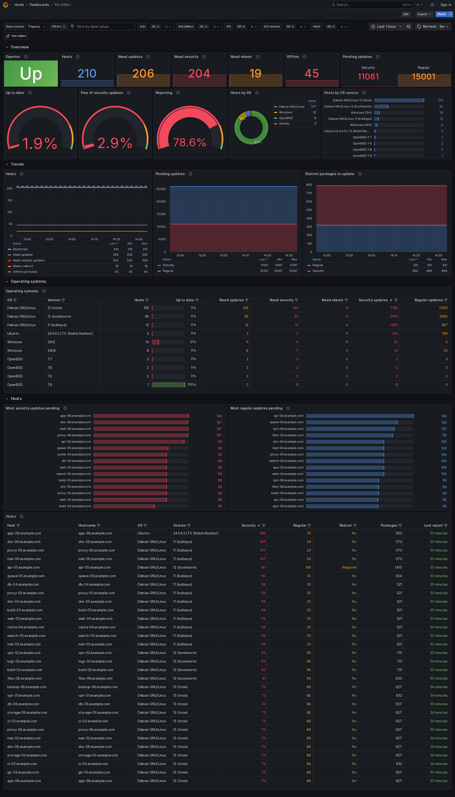

# Grafana dashboard

`patchmon-dashboard.json` shows the patch status of the hosts monitored by
PatchMon, from its Prometheus exporter (`/metrics`): hosts that need updates,
security updates or a reboot, offline hosts, pending updates per OS version and
per host, and how all of these change over time.

Built and tested on Grafana 12.0.



## Before you import it

1. Turn the exporter on in PatchMon: **Settings → Metrics**. `/metrics` has no
   authentication, so restrict it at the network or reverse-proxy level.
2. Have Prometheus, or a compatible store such as Thanos, Mimir or
   VictoriaMetrics, scrape it:

   ```yaml
   scrape_configs:
     - job_name: patchmon
       scheme: https
       scrape_interval: 1m
       static_configs:
         - targets: ["patchmon.example.com"]
   ```

## Import

In Grafana, **Dashboards → New → Import**, upload `patchmon-dashboard.json`
and pick the Prometheus data source that scrapes PatchMon.

When you provision the file instead of importing it, Grafana does not ask:
replace `${DS_PROMETHEUS}` in the file with the data source's uid first, or
pick the data source in the **Data source** selector.

If your Prometheus, Thanos or Mimir requires a label on every query, such as a
tenant label, the panels show errors until you add that label in **Filters**
and save the dashboard.

## Selectors

| Selector | Use |
|---|---|
| Data source | The Prometheus data source that scrapes PatchMon. |
| Filters | Extra label filters added to every query. Save the dashboard to keep them. |
| Job, PatchMon | The scrape job and the PatchMon instance, when you scrape more than one. |
| OS, OS version, Host | Narrow the panels to some hosts. |

## Good to know

- **Offline** and **Distinct packages to update** come from totals that PatchMon
  computes over all its hosts, so the OS, OS version and Host selectors do not
  apply to them.
- **Pending updates** counts a package once per host that needs it; **Distinct
  packages to update** counts it once.
- In the **Hosts** table, **Last report** turns orange after 2 hours and red
  after 3 hours: PatchMon's errored and offline limits with the default
  60-minute agent update interval.
